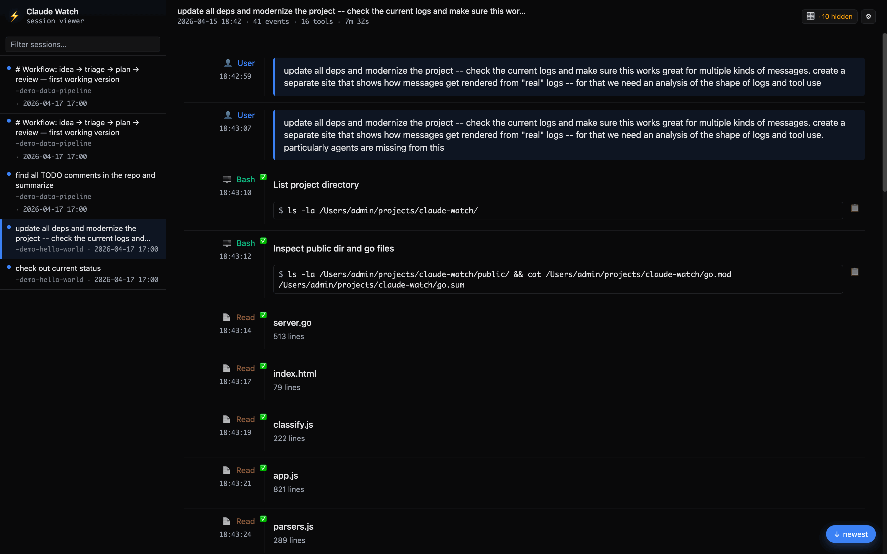

# cccp

Cloud Code Config Provider. A tool to sync `~/.claude` across machines.

Claude Code doesn't have a built-in cloud sync. For working across hosts and
VMs, I built this to synchronize memories, project notes, hooks, skills,
settings, and conversational history. Three particularities about the sync
mechanism: normal files (skills, hooks, memories, etc) use a last-write-wins
policy (but history is kept in the db), files ending in `.jsonl` (like
conversation logs) use append-only dedup, and deleted files are tracked through
tombstones. The binary uses as few dependencies as possible.

## Quickstart

```sh
# the server
export CCCP_TOKEN=$(openssl rand -hex 32)
cccp serve --port 12110

# a client (on any machine)
export CCCP_URL=https://your-server:12110
export CCCP_TOKEN=<same token>
cccp pull --full    # bootstrap: grab everything
cccp push           # ship local state
cccp watch          # incremental pushes on change

# anywhere
cccp explore        # only open logs ui on .claude folder (no sync)
```



### SAE conversation map

When an SAE dictionary is imported, Pravda shows feature activations in compact
tracks below the conversation. Search the feature selector to toggle multiple
features; colors stay consistent across tracks and message details. Select a
message in the map to inspect its values and jump to the corresponding event.
Overview and heatmap views provide alternative ways to explore the same data.

Open **Settings → SAE display and status** to choose a dictionary, configure
default features and colors, adjust the display threshold, and inspect index
availability. Display preferences are saved in this browser per dictionary;
individual conversations can override the defaults. Missing records are shown
separately from imported records whose activations fall below the threshold.

Activation percentages are rounded, scaled values clipped at 100. They are
not probabilities or confidence scores and do not have to add up to 100.
The same dictionary also analyzes thinking, tool inputs and text results, and
other events containing readable text. These features describe Laguna’s
representation of that text, regardless of which agent produced it. Image
results and events containing only timing or other metadata are excluded.

With on-demand scoring configured, viewing an unscored text event queues its SAE
execution and shows progress while the conversation remains usable. Results
are stored per message and dictionary and reused on later visits. Interrupted
jobs resume after restart; temporary failures retry with capped backoff until
the service recovers. Permanent errors stop retrying and show as failed.
Inputs up to 1 MiB are supported. When the capture token limit is exceeded,
the text is split without truncation and chunk activations are averaged by
token count before SAE scoring. Chunks have independent model context; this
is not equivalent to processing the entire text in one context window.
Status covers
the imported index and these jobs; it does not monitor external training.

To enable scoring, pass `--sae-capture-url http://HOST:PORT` and
`--sae-models-dir /path/to/models` to `cccp serve` (NixOS:
`services.cccp.saeCaptureURL` and `saeModelsDir`). Each dictionary needs
`models/ENCODER_SHA256/sae.safetensors` and its original `scored.safetensors`
or a `scale.safetensors` containing the original `scale` tensor. The worker
verifies the weights' SHA256 and preserves the dictionary's original scaling;
new dictionaries need their matching files installed before on-demand scoring
is available. The capture service must expose `/v1/laguna/capture`.

## Other agents

The same binary syncs Codex, Hermes and OpenCode. `--agent NAME` (or
`CCCP_AGENT`, or `"agent"` in the config file) picks a profile: the agent's
own state directory becomes `--dir`, the profile's allowlist decides what ships,
and everything lands on the server under `agent/<name>/`, so the sessions show
up in pravda alongside Claude's.

```sh
# per-agent config lives in the agent's own dir: ~/.codex/cccp/config.json,
# ~/.hermes/cccp/config.json, ~/.local/share/opencode/cccp/config.json
cccp watch --agent codex
cccp push  --agent hermes
```

Codex already writes JSONL rollouts; Hermes and OpenCode need the plugin from
`plugin/<agent>/`, which writes a JSONL transcript per session and starts the
daemon via `cccp watch hook-start --agent <agent>` (see each plugin's README).

## The Apparatus

One binary to rule them all. The party does not tolerate unnecessary
proliferation of executables.

`cccp serve` runs the central server. `cccp pull` retrieves files. This tries
to be as unopinionated as possible; the rest of the tool introduces more
nuanced choices.

cheka (the secret scanner) is the Secret Police, built into `cccp push`. It
detects API keys, tokens, passwords, private keys, and other secrets before
they leave the motherland. Findings are local-only. Pulls are intentionally
unscanned - what the central server sends is, by definition, correct and
trustworthy. The trust boundary, plainly: content pushed to the central
server is trusted and never re-scanned on pull, so a compromised server
could deliver unscanned content to every client.

`cccp watch` is the Secretary General. A tireless daemon that watches
`~/.claude` for changes and pushes them, subscribes to the server's SSE
stream and pulls on remote changes. It can run standalone or be driven
by Claude Code's session hooks. No orphan processes shall haunt the
workers' machines.

`cccp explore` is the Voice of Truth. A session viewer that renders
Claude Code conversations as rich timelines - tool calls, responses,
thinking blocks, metadata - all server-rendered with HTMX. No React
(bourgeois decadence), no build step (unnecessary complexity is the
enemy of the people). Also ships embedded in `cccp serve`.

## The Secretary General

The Secretary watches `~/.claude` via fsnotify, pushes on a 500ms
debounce window, and pulls immediately when the server broadcasts an
SSE event from another host. Three goroutines coordinate through
channels - because concurrent access to `state.json` is
counter-revolutionary.

Unlike a manual `cccp push`, the Secretary defaults to `--cheka-redact`:
secrets found in log lines are replaced with `[REDACTED:kind]` and the
push proceeds - a daemon that silently stops syncing serves nobody.
Set `cheka_redact: false` (or `--cheka-redact=false`) to restore
blocking. Blob files containing secrets still block either way.

You can run the daemon directly:

```sh
cccp watch --url https://your-server:12110 --token "$CCCP_TOKEN"
```

### Wiring as a Claude Code plugin

Add to `~/.claude/settings.json`:

```json
{
  "hooks": {
    "SessionStart": [{
      "matcher": "",
      "hooks": [{ "type": "command", "command": "cccp watch hook-start" }]
    }],
    "SessionEnd": [{
      "matcher": "",
      "hooks": [{ "type": "command", "command": "cccp watch hook-end" }]
    }]
  }
}
```

`hook-start` spawns the daemon and records the session. `hook-end`
drops it. When the session count hits zero: SIGTERM, clean exit, no
questions asked.

### Manual control

```sh
cccp watch status   # PID, session count, daemon state
cccp watch          # blocking foreground (for interrogation)
cccp watch stop     # SIGTERM the daemon
```

## Pravda (the web transcript viewer) - the Voice of Truth

Browse Claude Code sessions as rich timelines from any machine in the
fleet. Dark and light themes, responsive layout, live updates via
WebSocket.

```sh
cccp explore                        # ~/.claude/projects/ by default
cccp explore /path/to/projects      # custom directory
cccp explore -p 8080                # custom port (default 9123)
```

Also ships embedded in `cccp serve`, served at the root URL, gated by
cookie auth (same token as the sync API). The people deserve
transparency.

## Configuration

The party has determined that configuration requires four layers of
bureaucracy, each capable of overriding the one below it:

1. Built-in defaults
2. Config file (`$dir/cccp/config.json`)
3. Environment variables (`CCCP_URL`, `CCCP_TOKEN`, `CCCP_DIR`, ...)
4. CLI flags (`--url`, `--token`, `--dir`, ...)

An explicit empty string in a higher layer overrides a non-empty value
below it. False and unset are not the same - a philosophical truth that
transcends mere programming.

The allowlist (which paths under `~/.claude` to sync) lives in the
config file only. Ordered arrays are awkward to quote in shells, and
this is a set-once-per-host knob. The default syncs: `agents/`,
`commands/`, `file-history/`, `hooks/`, `memory/`, `paste-cache/`,
`plans/`, `projects/`, `skills/`, `tasks/`, `CLAUDE.md`,
`settings.json`, `history.jsonl`.

See `man cccp` for the full flag and environment variable reference.

## HTTP API

All endpoints require `Authorization: Bearer $TOKEN`.

| Method | Path | Purpose |
|--------|------|---------|
| `POST` | `/ingest` | Submit file manifest (NDJSON). Server responds with SHAs it needs. |
| `PUT` | `/blob/{sha}` | Upload a content-addressed blob. |
| `GET` | `/current` | Download LWW snapshot as a tar archive. |
| `POST` | `/log/append` | Append jsonl lines (deduped by content hash). |
| `GET` | `/log/since?since={ns}` | Fetch log lines newer than cursor. |
| `GET` | `/events` | SSE stream - ticks on every push, tagged with host ID. |
| `GET` | `/healthz` | Returns `ok`. No auth required. |

## Installation

```sh
# from source
go install github.com/eordano/cccp/cmd/cccp@latest

# nix
nix profile install github:eordano/cccp

# nixos module
{
  inputs.cccp.url = "github:eordano/cccp";
  # ...
  services.cccp = {
    enable = true;
    package = inputs.cccp.packages.${pkgs.system}.default;
    tokenFile = "/run/secrets/cccp-token";
  };
}
```

The Nix flake ships the binary, man page, and shell completions
(bash, zsh, fish). The NixOS module runs the server under systemd with
`LoadCredential` for the token.

## Not in scope

Telemetry ingest, eviction, PII scrubbing, built-in TLS. TLS is
terminated upstream by Caddy, nginx, or Tailscale Funnel. The party
does not concern itself with the bourgeois complexities of certificate
management.
